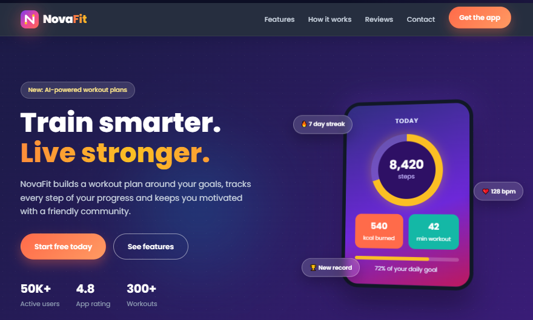
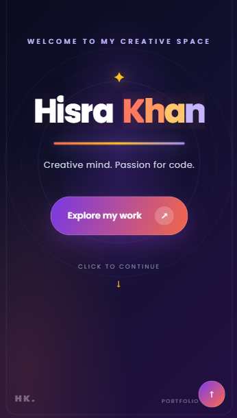

# 🚀 NovaFit Landing Page

A visually polished, fully responsive static landing page for **NovaFit**, a fictional fitness app. Built with **HTML5 and CSS3 only** (Flexbox + CSS Grid, **no JavaScript**).

> **Oasis Infobyte Internship**: Web Development & Designing, Level 1, Task 1

## ✨ Features

### Required checklist
- Sticky navigation bar with 4 links and a call-to-action button
- Hero section with headline, subheadline, two CTA buttons, stats and a CSS-drawn phone mockup
- Three content sections: Features (6 cards), How it works (3 steps) and Reviews (3 cards)
- Call-to-action banner and footer with contact and social link placeholders
- Consistent colour palette (navy, violet, coral, mint) applied through CSS variables
- Responsive layout (desktop, tablet and mobile) using Flexbox, Grid and media queries
- Intentional spacing: global `box-sizing: border-box`, consistent padding and margins
- Typography: Poppins font with clear heading and body sizes

### Extra touches
- Animated welcome screen with a name reveal, followed by a project intro screen (CSS only)
- Custom SVG logo defined once with `<symbol>` and reused with `<use>`, plus an inline SVG favicon
- Mobile hamburger menu built with a CSS-only checkbox toggle
- Scroll progress bar and scroll-reveal animations using CSS scroll-driven animations (wrapped in `@supports`, so older browsers simply skip them)
- Marquee band, floating hero chips and a back-to-top button
- Smooth scrolling between sections (pure CSS)
- Respects `prefers-reduced-motion` for accessibility

## 🧱 Tech stack

HTML5, CSS3 (Flexbox, Grid, CSS variables, keyframe animations, media queries). No JavaScript, no frameworks.

## 📁 Project structure

```
WebDev-L1-LandingPage/
├── index.html
├── style.css
├── README.md
└── screenshots/
    ├── desktop.png
    └── mobile.png
```

## ▶️ How to run

1. Download or clone this repository.
2. Open `index.html` in any modern browser (or use the VS Code **Live Server** extension).

The page opens on a welcome screen. Scroll down (or click **Explore my work**) to reach the project intro and then the NovaFit landing page itself.

## 📸 Screenshots

| Desktop | Mobile |
|---|---|
|  |  |

## 🎨 Design notes

- **Colours:** deep navy and indigo for trust, violet for brand, coral for action buttons, mint and sun-yellow as accents.
- **Layout:** one container width (1120px) used across all sections for a clean alignment.
- **Floating chips:** the small chips next to the phone mockup are decorative and intentionally positioned.
- **Browser support:** scroll-driven animations work in current Chrome and Edge; other browsers show the same page without those animations.
- **Fonts:** Poppins is loaded from Google Fonts, with system fonts as a fallback when offline.
- **Inspiration:** layout principles studied from modern SaaS and app landing pages. All code and content are original.

## 👤 Author

**Hisra Khan** | Oasis Infobyte Web Development Intern