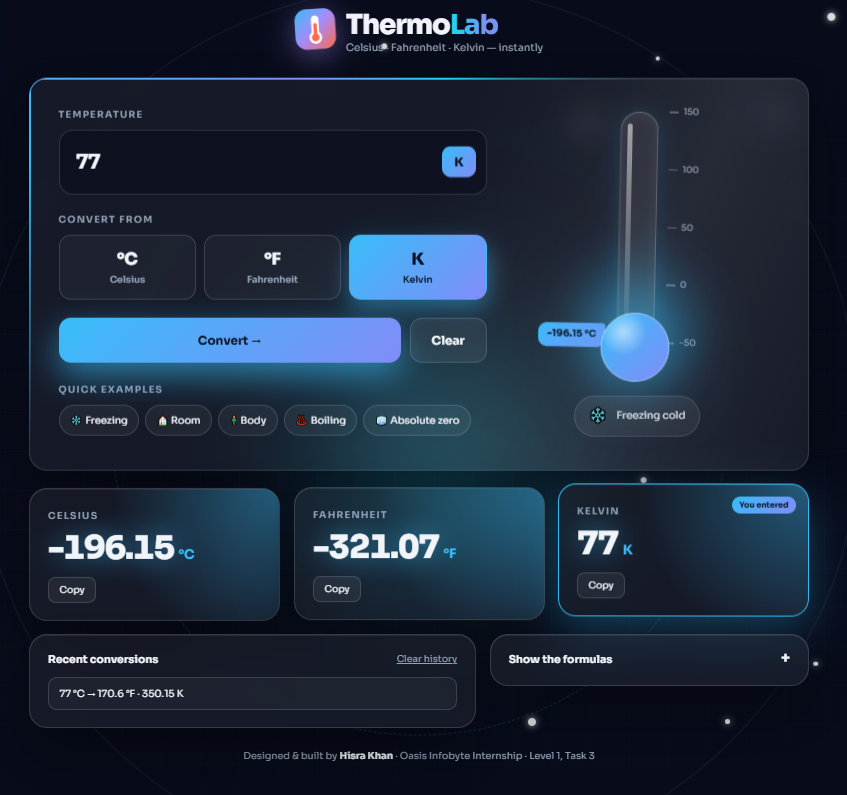
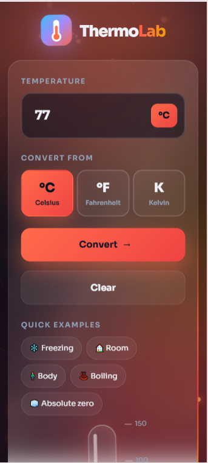
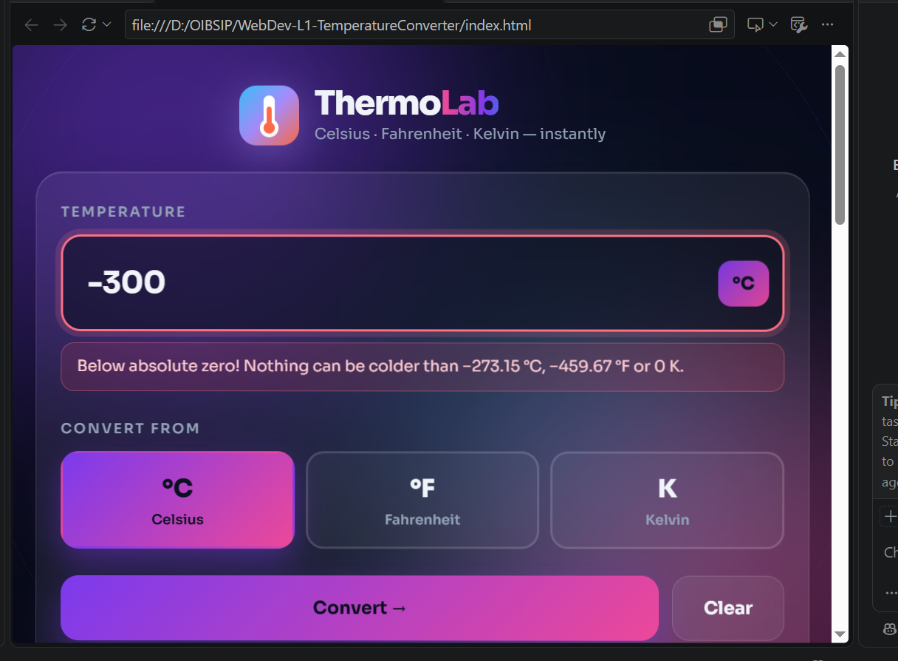

# 🌡️ ThermoLab | Temperature Converter

An interactive web tool that converts temperatures between **Celsius, Fahrenheit and Kelvin**, with live input validation and absolute zero protection. An animated thermometer and the page colours react to the temperature you enter.

> **Oasis Infobyte Internship**: Web Development & Designing, Level 1, Task 3

## 📸 Screenshots

| Desktop | Mobile | Absolute zero error |
|---|---|---|
|  |  |  |

## ✨ Features

### Required checklist
- **Numeric input** with validation: empty input, letters, symbols and malformed numbers (like `12abc`, `--5`, `1,5` or `1e3`) are rejected with a clear message
- **Unit selector** (radio buttons) for Celsius, Fahrenheit or Kelvin
- **All units at once:** Celsius, Fahrenheit and Kelvin are always shown together, and the unit you entered is tagged "You entered"
- **Convert button** triggers the calculation (the Enter key works too)
- **Results** with the correct unit labels (°C, °F, K), rounded to 2 decimals
- **Absolute zero protection:** values below −273.15 °C, −459.67 °F or 0 K show a friendly error
- **Clean, centred layout** with clear labels

### Extras
- Live validation while typing, and automatic re-conversion when you switch units
- Animated thermometer with a moving marker and bubbling liquid
- Numbers count up smoothly to the result
- Background colours change with the temperature (icy blue to hot red), with snow or ember particles
- Quick example chips: freezing, room, body, boiling and absolute zero
- Copy button on each result
- Recent conversions history (last 6, click one to load it again)
- "Show the formulas" section
- Responsive from desktop down to small phones, keyboard friendly, and `prefers-reduced-motion` is respected

## 🔢 Formulas

Every input is converted to Celsius first, then from Celsius to the other units.

| Conversion | Formula |
|---|---|
| °C → °F | `F = C × 9/5 + 32` |
| °F → °C | `C = (F − 32) × 5/9` |
| °C → K | `K = C + 273.15` |
| K → °C | `C = K − 273.15` |

## ✅ Tested examples

| Input | Celsius | Fahrenheit | Kelvin |
|---|---|---|---|
| 0 °C | 0 | 32 | 273.15 |
| 100 °C | 100 | 212 | 373.15 |
| 98.6 °F | 37 | 98.6 | 310.15 |
| 300 K | 26.85 | 80.33 | 300 |
| −40 °C | −40 | −40 | 233.15 |
| 0 K (absolute zero) | −273.15 | −459.67 | 0 |

**Rejected inputs:** an empty field, `abc`, `12abc`, `1,5`, `--5`, `-273.16 °C`, `-459.68 °F` and `-0.01 K`.

## 🧱 Tech stack

HTML5, CSS3 (Grid, Flexbox, custom properties, `@property`) and vanilla JavaScript. No frameworks.

## 📁 Project structure

```
WebDev-L1-TemperatureConverter/
├── index.html
├── style.css
├── script.js
├── README.md
└── screenshots/
    ├── desktop.png
    ├── mobile.png
    └── error.png
```

## ▶️ How to run

1. Download or clone this repository.
2. Open `index.html` in any modern browser (or use the VS Code **Live Server** extension).

Google Fonts need an internet connection; system fonts are used as a fallback when offline.

## 👤 Author

**Hisra Khan** | Oasis Infobyte Web Development Intern